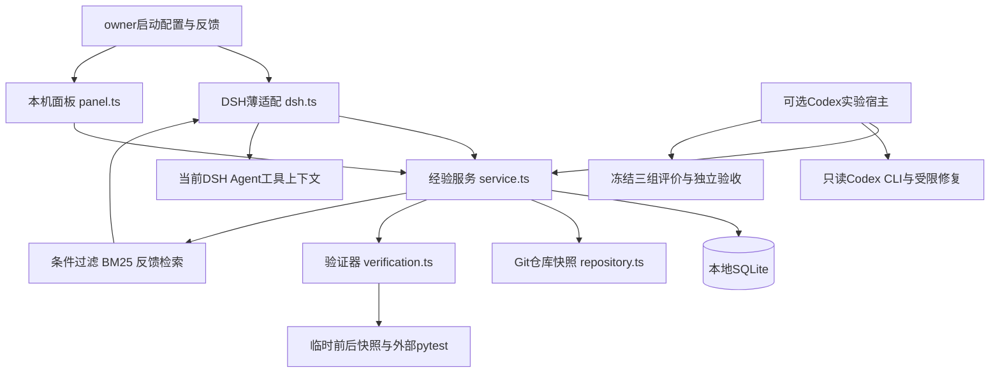
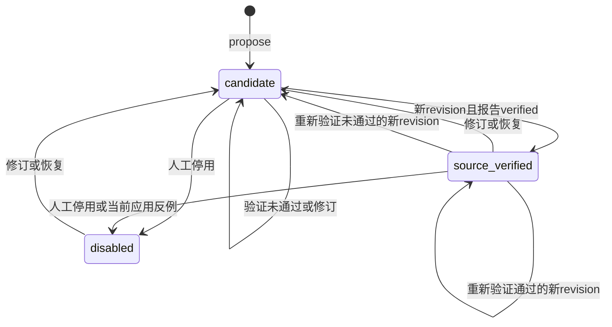

# DSH-Evolve 架构总纲 v0.2

## 1. 范围、权威与版本

日期：2026-10-19。对应[产品需求v0.2](product.md)及[ADR012](decisions/012-detailed-design-baseline.md)，T009 / Issue #27。T009运行核对基线为`bd724ccf03eb50314b29e132df1cbf6210c6c81c`。T010从已合并`bdf778cd0fc8172e3a2da976f72b17df6eb2ad4f`增加事实来源切片，实施前[ADR013](decisions/013-fact-evidence.md)固定契约；本总纲随实现更新。

本总纲回答模块职责、数据和状态契约、信任边界、正常与异常路径、验证与缺口。标为“当前”的内容是已存在代码；标为“目标”的接口是逻辑设计，**尚无对应导出、数据库列、后台worker或HTTP路由**。实施目标契约前须另立任务设计及迁移／兼容验收。

| 版本轴 | 当前值 | 约束 |
|---|---|---|
| 本文／PRD | v0.2 | 文档细化，不改变运行格式 |
| npm源码包 | 0.1.0-alpha.0 | 未向npm／Release发布 |
| Task／Experience JSON | schemaVersion 1 | 不能与SQLite版本混同 |
| Verification JSON | schemaVersion 2 | 含用例身份和验收输入 |
| SQLite | user_version 3 | 新库及v1/v2事务迁移，v3可读；拒绝未知版和旧程序混跑 |
| 评价报告 | v1／v2／v3 | 各自可读，不能改写旧实验 |
| 产品选择 | evidence-v1 | 每条事实来源完整后使用feedback-v1内核 |
| 冻结历史模型配方 | bm25-v1／feedback-v1 | 显式固定，未改为evidence-v1，不评价新策略收益 |
| DSH／Cordis | 0.2.0-rc.2／4.0.5 | 固定发行包与运行证据，不追master |

历史ADR状态是当时快照；现行覆盖结合[兼容性](compatibility.md)、[开发状态](development/status.md)和本文件。重要决策变更需显式替代ADR，不删除历史。

## 2. 系统上下文与信任边界



| 边界 | 可信来源 | 必须拒绝或限制 | 当前限制 |
|---|---|---|---|
| owner→配置 | 本机启动者指定路径／信任 | 模型、面板不得更改执行或共享权限 | 无团队身份／权限系统 |
| DSH→核心 | 官方session、ToolExecution及显式参数 | 跨session、错误cwd、非法schema | Agent提供的自然语言仍可能错误 |
| 历史经验→模型 | 仅资格通过且owner允许 | 不当作指令优先级或授权 | 当前返回完整Experience，无独立总token预算 |
| Git／pytest→证明 | 固定对象、独立验收及真实用例结果 | 工具isError、自评、跳过不得冒充成功 | 受信任代码，同一已安装Python环境 |
| HTTP→服务 | loopback＋Bearer＋同源写 | 未授权读、跨源写、任意命令／文件读取 | token持有者可操作本仓库数据 |
| 实验→产品库 | 冻结协议指定积累反馈 | 评价任务不能反向污染经验库 | 小实验无真实用户身份归因 |
| 文件系统→SQLite | 核心服务校验关系与revision | 非法格式、陈旧更新 | 直接改库不在防篡改保证内 |

临时目录隔离文件版本，不隔离恶意代码的网络、系统调用或宿主文件访问。当前只允许显式受信任仓库执行；不能宣传成安全沙箱。

## 3. 核心不变量与事实所有权

1. task归属由显式边界、session和精确仓库共同确定；closed不代表成功。
2. 修复证明由固定版本和外部pytest决定，模型不能声明`verified`。
3. candidate／disabled／缺有效来源证明的经验不能自动选入。
4. 经验有精确revision；历史内容不可原地覆盖。反馈绑定实际应用版本。
5. 修订和恢复必须成为新candidate，不能继承旧证明或旧版反馈效用。
6. 一次来源成功不证明自然语言策略普遍正确，也不证明后续收益。
7. 没有匹配是有效结果；不得为提高命中率取消条件或拒绝门槛。
8. Application只记录选择返回路径；读取、遵循、因果收益无证据则未知。
9. 执行、共享与未来提炼传输授权分别处理；事件观察不构成授权。
10. 失败、未运行、取消、漂移、无改善和未知成本必须保留区别。

| 事实 | 唯一依据 | 不可替代来源 |
|---|---|---|
| 代码版本／条件 | Git对象及文件hash | 模型描述 |
| 来源修复 | Verification三段用例结果 | Agent完成语、工具运输状态 |
| 当前策略内容 | SQLite experiences＋revisions | 可变面板缓存 |
| 明确使用反馈 | Application关联的追加Feedback | 自动猜测用户情绪 |
| 实验调用／暴露 | 宿主执行记录、协议资格及精确引用 | 计划中列出的经验 |
| 收益 | 冻结三组独立验收及完整统计 | accepted、安装成功或命中数 |

## 4. 模块职责与依赖

当前源码均位于`src/`。核心服务不导入DSH类型；DSH只负责官方边界适配。原v0.1的“selection模块”实际由`service.ts`组织，不存在`selection.ts`文件。

| 模块 | 输入→输出 | I/O与副作用 | 失败与限制 |
|---|---|---|---|
| domain.ts | unknown→严格对象／校验错误 | hash、限长、模式脱敏 | 不能校验文字语义真实性 |
| evidence.ts | 最小纠正/报告及事实引用→摘要、完整性 | 校验task/repo/index/hash和来源；本地读取 | 出处一致不等于文字蕴含/真值 |
| repository.ts | Git根／文件选择→快照、条件 | 只读Git及regular file | 非根、越界、缺文件拒绝 |
| store.ts | 严格对象→当前／历史／查询 | 同步SQLite、SAVEPOINT事务 | 不支持未知版本，revision冲突 |
| service.ts | 任务／候选／反馈→业务结果 | 编排store、快照、验证、选择 | 无后台自动提炼／耐久Job |
| verification.ts | commit对＋策略→报告 | 临时目录、Python子进程 | 未信任拒绝；基础设施异常可能无报告 |
| retrieval.ts | 摘要／候选文字→分数及拒绝 | 纯本地BM25 | 无语义理解／训练 |
| feedback-retrieval.ts | 同版应用反馈→备用表述／精确排除 | 从本地记录派生，不改经验正文 | 错误accepted可污染 |
| config.ts | JSON／启动输入→固定service | 解析路径、打开本地库 | 严格字段，默认执行／共享关闭 |
| dsh.ts | 官方工具／事件→核心调用 | 注册六工具、prompt、监听器 | 不注入llm；真实模型闭环未验证 |
| panel.ts | 本机HTTP→状态／生命周期操作 | loopback、受保护API | 无任意执行、分页或配置编辑 |
| cli.ts | panel／evaluate参数→入口 | 本机服务／评价JSON读取 | 不自动学习或发布 |
| codex-runner.ts | 明确实验请求→受限结构化提案 | 可选只读CLI、有限JSONL元数据 | 不是DSH模型凭据桥梁 |
| evaluation.ts | v1记录→一致性检查／统计 | 读取结构化结果 | 不生成真实结果 |
| paired-evaluation.ts | v2冻结计划／证据→可比结果 | 调用资格／库引用检查 | 旧bm25配方保持固定 |
| feedback-experiment.ts | v3积累＋评价→反馈对照 | 一次性资格、来源连续性 | 不允许评价反馈改库 |

脚本负责合成案例、安装探针和明确开启的实验；它们不是自动后台服务。面板和DSH可共享一个数据库，但这不构成跨进程任务队列。

## 5. 数据模型与持久化契约

### 5.1 标识、文本与作用域

- 业务ID是UUID；Git SHA是40位小写hex，内容摘要SHA256是64位hex。
- 通用文本trim后1–4000字符，标题1–160；不是token计量。
- 路径为长度≤240的仓库相对路径，拒绝绝对路径、盘符、反斜线、控制字符及空／点／双点片段；读取还核对realpath与regular file。
- repoId是**本地规范Git根绝对路径的SHA256**，不是远端URL身份。Windows短路径别名统一，子目录不能充当根；移动／clone无透明迁移。
- dependencyDigest只摘要已有的`pyproject.toml`、`requirements.txt`、`requirements-dev.txt`、`poetry.lock`、`uv.lock`、`Pipfile.lock`；不代表实际安装包或系统环境。
- Scope为`{repoId, dependencyDigest, requiredFiles: {相对路径: hash}}`，最多20个条件文件。propose／revise时取当前文件内容；begin快照保存起始commit。

### 5.2 当前对象字段

以下省略TypeScript具体语法，字段名与`domain.ts`一致，不增加隐含字段。

| 对象 | 字段 | 关系与限制 |
|---|---|---|
| Task v1 | schemaVersion,id,sessionId,summary,scope,baseCommit,state,createdAt | sessionId≤128；open／closed |
| Candidate输入 | title,strategy,observedFacts,inferences,recommendations,requiredFiles | facts 1–12，推断／建议各0–12，文件1–20；严格模式 |
| Experience v1 | schemaVersion,id,revision,sourceTaskId,title,strategy,observedFacts,inferences,recommendations,scope,status,reason,verificationId,createdAt | revision正整数，verificationId可null；条件文件在scope内 |
| Verification v2 | schemaVersion,id,sourceTaskId,repoId,baseCommit,fixCommit,acceptanceDigest,acceptanceFiles,environment,commands,base,fixed,regression,verified,reason,diff,createdAt | 验收1–100文件；diff≤8000字符 |
| TestRun | exitCode,tests,failures,errors,skipped,durationMs,timedOut,summary,cases | exitCode可null，摘要≤2000字符，cases≤10000 |
| TestCase | id,status | id≤2000；passed／failed／error／skipped |
| Application | id,taskId,experienceId,revision,reason,createdAt | 绑定选择的精确版本，没有delivered／adopted字段 |
| Feedback | id,applicationId,outcome,note,extraCost,humanRework,createdAt | 成本非负可null；返工非负整数可null |
| Evidence v1 | schemaVersion,id,taskId,repoId,kind,digest,createdAt；correction另有note，verification另有verificationId | 服务构造，不可变；只复制最小纠正或引用完整既有报告 |
| FactCitation | factIndex,factDigest,evidenceId,evidenceDigest | index 0–11，一版≤36，每事实≤3，重复拒绝 |

`observedFacts`正文仍为字符串，事实引用在按经验revision保存的侧表。逐条核对来源存在、task/repo、文本hash与证据digest；缺失/错误默认拒绝复用。引用不等于文字主张已被来源蕴含，来源报告通过不能认证策略和所有文字。验收文件输入存path和UTF-8 content，单文件读取≤64KiB；环境是string record，只记录Node／Python／pytest／platform／dependencyDigest。

反馈枚举为`accepted/rejected/counterexample/irrelevant/unknown`。`extraCost`数据结构没有currency／unit；现面板提示USD，不能由此推定所有API历史数值单位一致或直接汇总金额。评价报告的`extraCostUSD`是另一字段。该语义缺口为G10。

### 5.3 表、事务与迁移

| 表 | 主要键／作用 | 写入语义 |
|---|---|---|
| tasks | id；JSON body | upsert任务状态 |
| experiences | id；revision＋body | 当前投影 |
| revisions | (id,revision)；body | 追加不可变历史 |
| verifications | id；body | 追加证明 |
| applications | id；body | 追加选择记录 |
| feedback | id；application_id＋body | 追加，查询按rowid |
| events | id；task_id、created_at、body | INSERT OR IGNORE去重；纠正只记evidenceId |
| evidence | id；task_id、created_at、body | 严格模式，不同载荷同ID拒绝，最小来源不可变 |
| fact_citations | (experience_id,revision,fact_index,evidence_id)；两个digest | 仅随新经验revision插入；证据ID索引用于清理 |

开启`foreign_keys=ON`；新增fact_citations对revisions(id,revision)和evidence(id)声明外键，防止引用清理裂缝。既有表仍未声明外键，task/repo和摘要等完整性依靠服务校验，底层Store是可信内部边界；不声称SQLite阻止所有悬挂引用。

`putExperience`要求新revision恰为当前+1，同事务写历史、当前及该版全部引用，不允许独立追加历史引用。使用SAVEPOINT支持嵌套，busy_timeout为5000ms。验证完成时重新检查revision，再同事务写报告和经验；负反馈追加与当前版停用也在事务中。

v1→v2迁移保留反馈／历史，移除旧application唯一反馈限制；旧报告补空cases并标未验证。旧当前source_verified追加candidate版本要求重验；历史保持。未知数据库版本拒绝打开。新增irrelevant不升SQLite版本，但含该枚举后旧程序不能解析，禁止混跑／直接降级；见[ADR003](decisions/003-evidence-migration.md)、[ADR010](decisions/010-feedback-retrieval.md)。

v2→v3只增侧表/索引，不重写旧JSON/历史/报告/应用/反馈；旧source_verified仍表示修复验证，缺事实来源时默认拒绝复用。v1保留上述迁移行为，创建侧表与迁移在同一外层事务，失败回滚，重开幂等。旧SQLite2程序会拒绝v3，不允许混跑/直接降级。详见ADR013。现有实验摘要不含侧表，仅用于固定旧策略；未来evidence-v1实验必须另冻结这些新输入。

### 5.4 当前没有的目标逻辑对象

| 目标对象 | 最小语义 | 实施前必须固定 |
|---|---|---|
| LearningJob | 输入摘要、任务边界、状态、调用资格、输出引用、失败原因 | 原子占用、重启与不重试规则、事务发布 |
| ExtractionPort | 经授权的最小证据包→候选及主张引用／拒绝 | DSH官方接口、模型预算、结构化输出与注入防护 |
| ExperienceContext | 适用条件、策略、必要依据、精确revision／摘要 | DSH字节／token预算、截断顺序、交付回执 |
| DecisionRecord | 快照／策略摘要、候选与拒绝、交付及后续结果 | 状态定义、幂等与并发提交边界 |

最小Evidence/FactCitation已由T010落地，自动错误尝试归并、更多来源种类和主张语义核对仍属G01/G02。上表其余对象是后续任务的设计方向，**不是当前公开类型**。不能提前向现行工具发送这些字段；严格schema会拒绝未知输入。

## 6. 状态机与生命周期

### 6.1 当前状态



停用操作也可对disabled再追加版本；禁止直接验证disabled，须先修订／恢复。restore复制历史内容／scope到新candidate，verificationId=null；没有代码回滚。修订保留sourceTaskId，当前不支持把经验重新绑定另一来源任务／起始commit。

linkEvidence规范化比较引用集，相同则返回原revision、保留反馈。source_verified且事实来源完整时拒绝变化，DSH无内容修订工具，owner须检查反馈后显式revise为candidate。其余来源变化追加新revision，保持文字/状态/既有修复证明；不会重新pytest或给候选/停用提权。来源pytest重验不能消除后续任务反例，跨UUID重复候选仍属E05。内容revise默认清空引用；显式传入且文本/来源匹配才接纳。verify/disable复制本版引用，restore复制目标版引用并重查，但仍candidate/verificationId=null。详见ADR013。

Task状态为`[*]→open→closed`；当前无重开／嵌套任务。observe、correction、select需open；propose与verify允许已有closed来源任务。重复begin报错，重复select在已有应用后返回空与`already_applied_one_experience`，不会重发同一上下文。

### 6.2 目标后台状态（未实现）

逻辑Job可经历queued→running→succeeded／failed／cancelled／unknown。unknown表示调用可能发生但结果未可靠落库；不能自动当失败重放外部调用。实际枚举、lease、超时及恢复策略由G03设计固定。

启动调度只依据完整的任务／证据边界。idle可唤醒检查，不能封闭任务、产生事实或授予accepted。缺来源、授权、预算或版本一致性时只产候选／拒绝记录。提取输出不直接授予source_verified。

## 7. 任务、事件与DSH接口

### 7.1 固定官方扩展面

当前插件name=`dsh-evolve`，inject=`tools,sessions,systemPrompt`。没有注入LLM服务、修改模型权重或直接拼装网络请求。systemPrompt section为`dsh-evolve:workflow`、order=1250，说明显式工作流、权限、未知和经验不可信边界。

工具须有session-backed Agent，取`ctx.sessions.get(exec.agent.id)`，cwd原生realpath与配置Git根一致；带task的工具再核对task session。不能用模型自传sessionId绕过归属。

| 工具 | 当前参数 | 输出 | 副作用／拒绝 |
|---|---|---|---|
| evolve_begin_task | summary:string | taskId,application,experience,reasons | 建task；共享开时select，否则sharing_disabled_by_owner |
| evolve_finish_task | taskId:string | closed Task | 只关闭边界，不验收 |
| evolve_record_correction | taskId,note:string | recorded:true,evidence:{evidenceId,evidenceDigest,kind} | open任务的脱敏最小证据与仅含引用ID的事件，同事务 |
| evolve_propose_experience | taskId,candidate:json,citations?:json | experienceId,revision,status,facts:[{factIndex,factDigest}] | Candidate不变，引用在外层可选；同事务写候选/引用 |
| evolve_verify_experience | experienceId:string | experienceId,revision,status,verificationId,facts,evidence | owner固定策略；新增最小报告来源；不授予文字真值 |
| evolve_link_fact_evidence | experienceId:string,revision:number,citations:json | experienceId,revision,status,provenance | 同session/repo，拒绝陈旧/错误摘要/越界等；相同引用幂等，完整已验证来源锁定 |

没有反馈、配置提权、任意命令或发布工具。反馈由owner面板／可信核心调用追加；核心API本身不提供外部身份认证。

### 7.2 当前事件协议

| 官方事件 | 幂等键 | 保存内容 | 不可推断 |
|---|---|---|---|
| session/event | session:<sessionId>:<seq> | 归属任务及event.type等最小元数据 | 用户主张、任务成功、完整轨迹 |
| tools/result | tool:<agentId>:<callId> | 工具名及transport_error／result_observed | pytest通过、最终修复有效 |
| 显式纠正 | 来源UUID | kind=explicit_correction、evidenceId；正文只在最小evidence | 自动纠正识别或认证真实用户原话 |

observe只附到该session的open任务，无任务忽略。不保留任意参数／结果正文；重复event ID忽略，**不会比较同ID载荷是否冲突**。当前无持久化水位、轨迹回放、自动失败尝试关联或重新归属。

监听异常catch后记录最小警告，不抛回事件主循环。初始化失败／显式工具报错是不同路径，不能把监听容错当作整个产品永不影响DSH的证明。

### 7.3 取消、卸载与兼容证据

verify使用工具signal与插件lifetime的合并取消信号；跟踪pending promises。卸载先标disposed、取消、等待settled，再关库；官方框架释放本组件工具和prompt。事件回调在disposed后不写入。

真实官方服务探针覆盖注册／执行begin和finish／session隔离／卸载后工具及提示移除；没有调用验证工具或制造pending验证，取消/等待pending仅经源码核对，未作实际取消测试。bundle验证官方空profile组合，tgz探针覆盖独立消费安装。Windows完整官方CLI/Web试装见[T006d](development/T006d-installation.md)。T011另用官方SDK真正Agent完成begin/纠正和有效修复提案，但候选引用失败、复用未开始（[记录](development/T011-acceptance.md)）。正常DSH完整自主学习、Desktop及其他平台完整应用仍为G05，不得由fixture或本次partial替代。

## 8. 来源验证管线

### 8.1 前置条件

1. owner executionTrusted=true；timeout整数100–120000ms。
2. 精确Git根，tracked修改已提交；不因untracked文件存在直接失败。
3. baseCommit为fixCommit祖先、二者不同，fixCommit是当前HEAD。
4. 候选条件hash仍一致。外部acceptanceDir realpath在仓库之外。
5. 验收集有test_*.py，递归收集.py（含conftest），拒绝symlink，跳过隐藏目录／__pycache__。

### 8.2 执行与通过条件

Git对象分别物化base／fixed临时目录；同一验收集复制到独立acceptance目录；生成隔离pytest.ini。顺序运行base验收、fixed验收、fixed回归：

```text
python -m pytest <target> -q -c <isolated-pytest.ini>
  --import-mode=importlib -p no:cacheprovider --junitxml=<report>
```

使用shell=false和过滤后的环境，设置snapshot的PYTHONPATH、禁用pytest第三方自动加载／字节码。当前报告commands保存验收／回归两种**命令摘要模板**，不是三次完整argv；精确开关由此代码版本及上述协议确定，未来独立重建套件应固化完整manifest。

| 阶段 | 通过依据 | 不通过／未知 |
|---|---|---|
| base | exit 1，真实failed cases，无error／timeout | 无收集、仅error、全skip或基础设施失败不算复现 |
| fixed | exit 0，至少真实用例通过，报告完整无失败错误 | 原失败用例skip／移除不算修复 |
| 用例对齐 | 集合／数量／唯一ID一致；原failed逐个转passed | 计数一样但身份不同也拒绝 |
| regression | exit 0，有实际通过，无错误失败 | 原有skip可保留；全skip不能证明回归通过 |
| 材料完整性 | 执行后验收副本摘要不变 | 变化抛错误，不能发布报告为verified |

输出和diff脱敏限长。保存验收UTF-8输入、SHA256、用例结果及有限环境；不采集全宿主环境变量。报告形成后在服务事务中重查revision，写报告及下一经验版本。

测试层面未通过可保存verified=false报告和candidate新版本；材料读取／进程基础设施／取消等抛错可能在报告形成前结束，**当前没有耐久Attempt记录**。调用方须保留错误，不能补造报告。

### 8.3 资源与安全边界

| 资源 | 当前上限／行为 | 尚不保证 |
|---|---|---|
| Git物化 | ≤5000文件；单blob≤4MiB；总≤64MiB；拒绝symlink／非blob | 不执行Git checkout hooks，不等于代码沙箱 |
| 验收 | ≤100个.py；每文件≤64KiB | 整个依赖环境固定 |
| pytest | 单子进程100–120000ms，默认15000ms；超时kill直接child | 完整后代树终止、全管线总deadline |
| 报告 | 单摘要≤2000字符、diff≤8000、cases≤10000 | 无限大输出完整存档 |
| 清理 | finally仅删除本函数在OS temp新建并校验的目录 | 不清理用户目录／不回滚代码 |

Codex执行器的进程树／继承管道期限加固不能套用到当前pytest实现。恶意代码、后代进程与环境再现为G08；失败Attempt及重启为G03。

## 9. 资格、排序和上下文交付

### 9.1 当前顺序

1. 要求open任务且尚无Application。
2. 排除来源任务、candidate、disabled。
3. 核对verificationId指向verified报告，来源task与repo匹配。
4. 生产默认evidence-v1还要求每事实≥1有效引用；检查归属、index/fact hash、证据digest及报告来源，无效则拒绝整条。显式历史bm25-v1/feedback-v1不新增这个门槛，冻结配方保持原行为。
5. 读取当前条件文件，精确repoId／dependencyDigest／requiredFiles hash匹配。
6. evidence-v1/feedback-v1排除当前revision、精确规范化任务摘要的irrelevant上下文。
7. 对合格经验原文做BM25；有任何合格原文命中就只比较原文。
8. 全部原文拒绝时才在accepted备用摘要上回退；bm25-v1不回退。
9. 结合当前revision效用排序，取一条；无匹配返回空与原因。
10. 写Application，再从begin工具返回Experience／Application／reasons。

选择与Application写入未由一个覆盖所有输入的跨进程CAS事务保护，表也无task_id唯一约束。因此“每任务最多一条”是当前服务顺序调用行为，**不保证多进程竞争下exactly-once**。选择后到工具返回间的代码变化也无全仓冻结。G03/G04须固定新的原子边界／重复回执。

### 9.2 BM25及反馈

固定k1=1.2、b=.75、标题频次权重2；NFKC、标识符拆分、固定停用词及中文相邻双字。查询去重，不按总长度扣分。`textScore=raw/(1+raw)`；至少2个内容anchor、1个标题anchor、score≥.2。这是工程门槛，不是相关性概率。

同版每次应用按追加顺序取最新非unknown反馈，随后去除irrelevant：
`utility=(accepted+1)/(known_without_irrelevant+2)`，
`combined=.7*textScore+.3*utility`。
按combined降序，同分按经验UUID。最新irrelevant不会回溯旧accepted计算该应用效用。

反馈表述必须同repo、同revision、非来源任务、关系完整；完整summary经NFKC／小写／trim／空白归一产生context key。每上下文取最新非unknown，最近最多8个accepted唯一摘要可作回退；原因记录feedback/application/task ID。历史摘要只用于本地检索，不另发给模型。

rejected／counterexample对当前实际应用版停用；irrelevant只精确排除表述，不传播到同义句。修订／恢复不继承旧效用或备用表述。无反馈时先验.5；小样本／错误反馈／语义否定／首次同义漏选都是当前限制。方法依据见[methods](methods.md)、[ADR009](decisions/009-retrieval-coverage.md)、[ADR010](decisions/010-feedback-retrieval.md)。

### 9.3 当前交付与目标预算

当前DSH返回完整Experience JSON，虽然字段和条数有限，**没有总字节／token硬预算，也没有只含必要事实的Context DTO**。Codex32KiB限制仅属于实验执行器。Application在返回前写入，没有模型读取或采用回执；失败重试不会自动重发同一经验。

目标G04：按稳定顺序保留条件、策略、最小证据与精确引用，超预算拒绝或明示安全缩减；绑定选择时快照及策略摘要；区分selected／offered／unknown等逻辑阶段。确切DTO、预算单位、硬阈值、收据持久化及官方DSH交付接口须另作设计，不在本次新增字段。

## 10. 反馈、并发与恢复

| 操作 | 当前原子／幂等边界 | 失败／恢复语义 |
|---|---|---|
| begin | 查open后新UUID、写Task | 重复报错；无幂等key／后台重建 |
| event | events.id冲突忽略 | 同key不同载荷不会诊断 |
| propose | 新UUID＋revision1，引用校验/历史/当前/引用同事务 | 重复提交仍可能生成不同经验 |
| linkEvidence | expectedRevision＋完整引用集；相同幂等，其余允许变化原子追加 | 完整已验证来源锁定；无部分写入；来源不足不满足默认资格 |
| verify | 异步运行后重查revision；报告＋新版本同事务 | 版本已变拒绝；进程中断无Job可恢复 |
| select | 顺序检查已有Application后写入 | 重复返回空；跨进程／交付裂缝未解决 |
| feedback | 同id同payload幂等；不同payload报错；停用同事务 | 更正需新id追加，按rowid而非时钟排序 |
| revise | expectedRevision＋putExperience递增约束 | 陈旧写拒绝，保原历史 |
| disable／restore | 事务内检查expectedRevision | stale返回冲突，旧反馈不禁新版 |
| clean | 事务删过期events及无历史引用的过期evidence | 任何历史版引用继续保留，FK防止删除已引用来源 |
| plugin unload | abort、等待pending、关库 | 进程被杀／机器断电不等于正常卸载 |

目标G03采用task-scoped协调和输入摘要：同输入只允许一次外部调用资格，未知不得自动重开，提交前再核对revision／证据；需要把文件与DB裂缝显式记录为未完成。具体lease、锁、状态schema、重试／人工恢复和并发测试由新ADR固定。不能将实验脚本的wx资格文件直接宣称为生产协调器。

## 11. 本机面板、CLI与配置

### 11.1 启动配置

| 字段 | 当前默认／约束 | owner意图 |
|---|---|---|
| repoRoot | 必填，必须精确Git根 | 固定操作仓库 |
| dataDir | 可选，默认home/.dsh/evolve/<repoId> | 数据不跟随DSH_HOME |
| executionTrusted | false | 允许运行受信任仓库pytest |
| shareWithModel | false | 允许返回存储经验，不授权原始材料提炼 |
| acceptanceDir | 可选，默认dataDir/acceptance-not-configured | 必须另配有效仓库外验收 |
| python | python | owner选的解释器 |
| regressionPath | tests，验证时安全相对路径 | 固定回归目标 |
| timeoutMs | 15000，100–120000整数 | 单pytest子进程期限 |

严格schema拒未知字段。DSH可由apply输入、`DSH_EVOLVE_CONFIG`指向的JSON文件或当前cwd默认配置启动；CLI panel显式`--config`。工具和HTTP没有修改信任、共享、路径的API。

### 11.2 HTTP当前契约

仅bind127.0.0.1随机端口，每次启动生成32-byte随机token。URL fragment携token，前端取后移除，不放localStorage；API请求Bearer认证。静态根页可无token，数据API不行。Host须精确本机origin，POST要求相同Origin及严格application/json，请求体≤32KiB。

| 方法／路由 | 输入／返回 | 错误与约束 |
|---|---|---|
| GET / | 静态面板 | CSP nonce、无外部资源 |
| GET /api/state | 原字段＋evidence,provenance | 需Bearer；每版完整性/引用/事实摘要与相关报告返回 |
| POST /api/feedback | Feedback去createdAt→追加Feedback | 严格schema，未知应用拒绝 |
| POST /api/cleanup | {}→removedEventSummaries,removedUnreferencedSources | 事务清理30天前事件及未被任何历史版引用的来源 |
| POST /api/experience/:id/revise | revision,reason,candidate,citations?→新candidate | 默认清空引用；UI保留未变事实引用；stale 409 |
| POST /api/experience/:id/evidence | revision,citations→当前或新revision | 相同幂等；完整已验证来源锁定，owner须先检查反馈并显式修订；stale 409 |
| POST /api/experience/:id/disable | revision,reason→新disabled | stale 409 |
| POST /api/experience/:id/restore | revision,targetRevision,reason→新candidate | 不直接激活旧证明 |

无token401、Host／同源不符403、未匹配路由404、非法输入通常400、RevisionConflict409。无任意命令、文件上传读取、HTTP验证或配置编辑端点。内容按文本DOM展示，no-store／no-referrer／nosniff，CSP禁止外部脚本和frame。无分页，state含全历史，大库成本为G10。

DSH Web认证与面板token不同：固定官方Web应从CLI打印的启动URL完成认证bootstrap；新的裸根URL可能401。不能把本机token写到README、PR或截图中。完整安装／模型体验范围见T006d记录。

## 12. 自动提炼的目标设计

**以下未实现，不能作为当前使用说明。**

1. G01把显式纠正、失败、最终commit、验证报告归并成最小证据包，逐条主张指向EvidenceRef；歧义归属交回owner，不跨任务补绑。
2. G02通过独立授权的ExtractionPort提交最小材料；不传完整会话、任意工具输出或凭据；模型输出严格候选／来源引用或拒绝。
3. 文字主张核对与运行证明分开：不在证据中的观察改为推断／删除；一次成功限定条件，不生成无条件规则。
4. G03记录输入摘要、外部调用资格和持久状态。中断未知不自动重试；重复证据不重复发布；陈旧版本不覆盖。
5. 模型提炼失败不阻塞开发；保留候选或拒绝及最小诊断。只由确定性验证器授予source_verified。
6. 需要以固定DSH官方类型／服务探针验证所选LLM／后台扩展面，再接真实模型会话；不能由当前没有llm inject的适配层推断已支持。

不照搬参考项目固定turn／时间阈值、完整Skill Catalog或发布所有权协议。本产品调度以任务和证据完整性为依据，产物首先是本地版本化经验。

## 13. 实验架构与方法边界

| 层 | 输入／控制 | 输出／证据 | 边界 |
|---|---|---|---|
| v1评价 | 手工结构化三组结果 | 完整性／泄漏／未知检查 | 不伪造调用 |
| Codex来源执行器 | 只读CLI、受限JSON提案、宿主allowlist及hash | 独立pytest来源案例 | 复用本机登录，不桥接到DSH模型 |
| v2配对 | 冻结任务／库／验收／策略／控制摘要 | 精确经验引用、实际调用与状态 | wx单次资格，不重开失败槽 |
| v3反馈对照 | 1积累＋2任务×3组，最多7新调用 | 来源连续性、积累反馈和三组结果 | accepted注明基准验收，非用户原话 |
| 未来真实任务评价 | 公开重建套件、任务族隔离、重复及人工观测 | 成功／复发／返工／误用／成本 | G06，尚未完成 |

当前真实CLI固定0.163.0-alpha.10.2，请求gpt-6.1-sol／low、HTTPS provider retry=0，90s期限；配对tool预算0，prompt32KiB／输出1MiB。只读结构化修复由宿主检查路径／原内容摘要后写入限定目标，验收目录不交给模型写。

Codex进程预算／取消／后代管道有专门测试；超时、缺完成、格式错或未知事件不能授权修复。模型请求标识不代表服务器权重完全冻结；seed、温度、总token／金额硬限未知，记录null。process-fixture明确不是模型。

实际提供数依据宿主启动的调用，不按计划清单。callStarted表示尝试，不是读过或采用。评价库冻结、评价反馈不回流；v2旧bm25配方与v3反馈配方分开，拒绝混合策略和来源漂移。

已运行与无改善详见[PRD评价](product.md#10-效果评价与验收口径)、[T008c](development/T008c-acceptance.md)。这不是正常DSH模型证据，也不是MemRL／GEPA训练。原始模型／私人材料留本机；未来公开可复现资产另设计，不上传真实用户数据。

## 14. 数据保留、运行资源与部署

- DB默认在本机用户目录，首次创建目录mode0700意图不等于跨平台ACL保证；没有数据库加密、云同步或团队权限。
- 过期事件及未引用来源由用户触发30天cleanup删除；没有后台自动过期worker。任务、证明、验收内容、历史、应用反馈不在普通清理范围。
- T010将纠正文放入最小evidence、事件只记ID；任何历史版引用会保留来源，缺失/摘要错则默认资格拒绝。完全删除、遗忘和导出仍需G07；这不是永远保留全部纠正。
- 脱敏为模式规则（常见token、赋值、邮件、本机路径），非语义隐私保证；不得把数据库、完整URL或原始报告提交Git。
- 选择与面板目前扫描本仓库记录，无向量服务、分页、容量SLO或实测大库延迟保证。字段限长不是总存储／执行成本上限。
- Node≥24.10，当前CI24.19.0；Python3.10／pytest9.1.1是已验证基线。跨环境来源重建需G06/G08，不仅是安装依赖声明。
- 部署形态：DSH组件＋本地SQLite＋可选独立面板；可选Codex／评价脚本是开发实验工具，不是必需线上服务。
- 本机tgz和Windows完整Web试装是预览；npm、GitHub Release和线上部署未发布。候选发布仍须单独授权及实际安装包验收。

关键取舍：薄适配降低DSH耦合；SQLite便于本地事务／审计；精确条件宁可拒绝；独立验收不由模型自证；BM25便于小数据解释；恢复为候选避免历史证明误继承。代价是泛化保守、自动体验未完成、并发／大库／环境重建能力有限。

| 当前选择 | 比较过的替代方向 | 维持当前选择的依据／重新考虑条件 |
|---|---|---|
| 本地SQLite＋核心服务 | DSH专用存储或云数据库 | 核心可脱离DSH验证、事务与历史可查；团队同步需求出现时另设计 |
| 显式任务工具 | 按idle或turn直接判断成功 | 可核对归属且不自证成功；G01/G03具备证据与恢复后再自动化 |
| 精确hash条件＋BM25 | 语义版本范围、embedding、学习排序 | 少数据可解释，优先暴露错误；独立误选/漏选证据支持后再比较 |
| 临时Git快照 | 容器或系统强沙箱 | 当前受信任代码可验证；不满足恶意代码隔离，G08按威胁模型决定 |
| 独立loopback面板 | DSH原生经验管理组件 | 当前功能可独立验收；G05验证官方UI扩展面与完整用户流程后再选 |

这些是现有决策及重新评估条件，不在T009替换存储、算法、隔离或UI架构。

## 15. 需求到实现与验证的追踪

ID以[PRD §6](product.md#6-编号需求)为准。下表完整覆盖58项；范围表示其中每个ID都受该行约束。`test/`文件是现有检查，**只证明已实现部分**，G列标出的目标仍未通过。实际运行状态读任务验收／当前PR CI，不由表内文件名推断。

| 需求ID | 设计／实现位置 | 现有检查或证据 | 未覆盖／限制 |
|---|---|---|---|
| B01 | §2–4、service／verification／dsh | core、dsh、demo | G05真实DSH |
| B02 | §3、8、13，domain／evaluation | core、evaluation、paired | 来源非收益 |
| B03 | §6、10，restore | core、panel | 不操作用户Git |
| B04 | §1、13–14，状态文档 | T006d、T008c、路线 | 未发布 |
| T01–T02 | §5、7，begin／requireTask | dsh、repository、core | 无begin幂等receipt |
| T03 | §3、6–7，finish／observe | dsh、core | G03自动调度 |
| T04 | §7、12，correction | dsh、core | G01自动归属 |
| T05 | §5、10，events | dsh | G03恢复／冲突载荷 |
| C01 | §7、14，observe／redact | dsh、core隐私检查 | 无完整轨迹 |
| C02 | §5、8、12 | core真实Git／pytest | G01错误尝试归并 |
| C03 | §5、8，Verification | core、codex acceptance preflight | 非完整环境manifest |
| C04 | §5.2–5.3、7、9，evidence.ts | evidence逐条摘要/归属/报告改动，panel/DSH关联 | G01自动归并/G02语义核对 |
| C05 | §5.3、14，cleanEvidenceWithRetention | evidence跨连接清理/FK/历史引用，core清理后证明 | G07彻底遗忘/导出 |
| C06 | §5.1、8，snapshot | repository、core scope | 条件充分性待评价 |
| E01–E02 | §5.2、12，Candidate／propose | domain严格schema源码核对；core候选拒选 | G02文字核对 |
| E03 | §3、5、12 | core条件边界 | G02提炼约束 |
| E04–E05 | §5.4、10、12 | 尚无自动提取测试 | G02/G03授权／预算／幂等 |
| V01–V02 | §8，verifyRepair | core信任／隔离 | G08强隔离 |
| V03–V04 | §8.2，verifiedCases／passes | core失败身份／skip／无收集 | 受信任pytest |
| V05 | §5.2、8 | core报告／demo | G06独立公开重建 |
| V06 | §8.3、10 | core仅timeout标志解析判断；取消/材料变动保护经源码核对 | 实际pytest超时/DSH取消未专项运行；G03/G08耐久Attempt/进程树 |
| V07 | §5.3、8，service.verify | core正常验证；事务内revision guard经源码核对 | panel stale仅覆盖生命周期；verify运行中竞争未专项执行 |
| S01 | §9.1，applicability | core依赖／代码、retrieval | G09主动过时 |
| S02 | §9.1，service.select | core、retrieval | G03跨进程唯一 |
| S03 | §9，reason／retrievalPolicy | retrieval、paired策略检查 | G04完整决策快照 |
| S04 | §9.2，feedbackMemory／utility | feedback-retrieval、core反馈 | 小样本、错误反馈 |
| S05 | §7、9.3，shareWithModel | dsh共享关闭／提示 | G04总预算与最小DTO |
| S06–S07 | §9.3、13 | paired实际启动；codex预算 | G04/G05生产交付／采用未知 |
| L01–L02 | §5、10，feedback | core追加／旧版反馈 | 核心身份信任调用方 |
| L03 | §9.2，feedback-retrieval | feedback-retrieval追加顺序／排除 | 精确表述非语义泛化 |
| L04 | §6、10，revise／restore | core、panel、migration | 来源task不可重绑 |
| L05 | §9、16 | core条件变化 | G09主动提醒 |
| L06 | §5.2、13，Feedback | evaluation未知保留 | G10成本单位 |
| U01–U02 | §11，panel | panel、本机浏览器记录 | G01证据粒度、G10语义 |
| U03 | §10–11 | panel鉴权／同源／stale | token持有者可信 |
| U04 | §7、11–12 | dsh／面板分别验证 | G01/G05正常联动 |
| D01–D02 | §5、11、14 | core脱敏／路径、panel | 非语义隐私保证 |
| D03 | §5.3、14 | evidence历史引用保留，core清理后历史 | G07完全删除/遗忘 |
| D04 | §7、11–12 | dsh／core默认拒绝 | G02提炼授权 |
| D05 | §5.3 | migration v1/回滚/未知版，evidence v2逐表保留/幂等 | SQLite2不能混跑3 |
| I01 | §1、7.3 | bundle／dsh／install-probe、T006d | 版本固定 |
| I02 | §3、7.2 | dsh、core真实pytest | 运输状态非验收 |
| I03 | §7.3、10 | dsh官方卸载移除工具/prompt；pending取消经源码核对 | 实际pending取消未专项运行；G03断电恢复 |
| I04 | §7.3、14 | T006d范围说明 | G05真实DSH／其他平台 |
| Q01–Q02 | §13 | evaluation、paired、feedback-experiment | G06真实／公开重建 |
| Q03 | §13 | evaluation未知／feedback recurrence | G06/G10人工／误用观测 |
| Q04–Q05 | §3、9、13 | paired未知与失败、T008c、methods | 少样本无普遍结论 |

测试定位为`test/<表中简称>.test.ts`：core、dsh、repository、retrieval、feedback-retrieval、panel、migration、bundle、evaluation、paired-evaluation、feedback-experiment、codex-runner。表中“paired”指paired-evaluation；没有测试名或范围暗示新目标已通过。

## 16. 缺口与实施依赖

下面是设计backlog。T010 / Issue #29已实现G01/G07显式来源切片，其余目标未自动创建或完成实现Issue。已有父[Issue #8](https://github.com/wang1299/dsh-evolve/issues/8)、[Issue #15](https://github.com/wang1299/dsh-evolve/issues/15)保持open。后续每项另固定范围、失败场景、任务分支和PR，不能把整张表塞进一个实现PR。

| 缺口 | 问题／目标 | 依赖 | 必须新增的验收证据 |
|---|---|---|---|
| G01 任务证据归并 | T010已有显式纠正/验证逐条来源；自动错误尝试归并待实现 | 本基线，协同G07 | 真实任务边界、歧义拒绝、跨session隔离、主张缺证据 |
| G02 授权自动提炼 | 官方DSH ExtractionPort，最小材料与主张核对 | G01、DSH接口任务设计、G03 | 授权关闭／预算／注入／无来源／重复输入，无模型虚构成功 |
| G03 耐久协调恢复 | Job／Attempt、外部调用资格、并发去重、未知恢复 | G01，先定持久化ADR | 两进程竞争、关键点中断、重复事件、陈旧发布、无资格重开 |
| G04 上下文与交付 | 最小DTO、硬预算、决策快照和重复回执 | G01/G03、现选择 | 超预算拒绝、版本漂移、返回失败、实际offered与unknown |
| G05 正常DSH闭环 | T011引导SDK真实运行partial；正常采集/复用/反馈仍缺，#33/#34跟进工具与用量 | G01–G04、固定发行版 | 一个完整真实模型案例及负路径，平台／模型／安装明列 |
| G06 可公开收益评估 | 独立重建合成资产＋真实任务族配对重复 | 现v2/v3，G04/G05按评价入口 | 外部只读验收、三组控制、任务隔离、全部失败与人工指标 |
| G07 保留与遗忘 | T010已保护历史引用最小来源/默认缺失拒绝；导出/彻底遗忘待设计 | G01共同设计 | 纠正30天后仍可溯源，删除失效，无隐私副本残留声明越界 |
| G08 验证执行增强 | 后代树、总deadline、环境manifest／强隔离选择 | 当前验证器、独立ADR | 进程后代／逃逸风险场景、取消清理、环境漂移、资源边界 |
| G09 主动过时检查 | 版本变化提示与待重验，不偷继承证明 | G01/G03、现scope | 文件／依赖变更、恢复、重新验证及通知去重 |
| G10 面板与指标语义 | 历史反馈提示、单位、未知、分页／容量 | 当前面板，新增状态随G01–G04 | 旧版反馈不误导、单位不混算、大历史和真实用户交互 |

优先先定G01/G07证据保留边界，再实现G02/G03；G04之后验证G05正常产品体验。G06先补公开重建与测量，再扩大任务，不用更多模型调用代替缺失观测。G08按执行风险单独开发，G09/G10随相关状态推进；未做容量实验前不承诺数值SLO。

## 17. 开发、测试与设计变更门槛

- 编号需求／黄金场景→任务Issue→codex分支→必要失败用例→实现→相关检查→Draft PR→稳定SHA独立只读评审→修复／必要复审→CI及保护检查→squash合并。
- 格式／公开工具／HTTP／授权／生命周期／执行边界变化先写ADR，说明兼容、迁移、失败恢复及验收；普通实现细节不机械审批。
- 当前CI在Windows／Ubuntu固定Node24.19.0、Python3.10、pytest9.1.1，执行check、官方兼容、demo、pack及真实tgz组件安装；这不是完整发行应用或模型收益验收。
- T009为历史纯文档交付。T010代码/迁移/接口变更执行53项本地检查、官方六工具/面板/真实Git-pytest、包安装及当前头CI，并由独立Agent审稳定SHA；没有新模型调用、完整Web安装重跑或收益结论。
- 独立AI评审须写SHA、基线、范围、证据与影响，不充当GitHub正式批准；P0/P1及影响当前验收／数据／安全／主要路径的可复现P2必须修。
- 计划、实现、验证、发布分别更新；不凭CI历史或测试数量合并，不上传私人报告、凭据或真实用户会话。

文档组织与契约颗粒度参考固定Run2Skill快照，引用与范围见[PRD §12](product.md#12-文档粒度参考)；产品、数据与实现仍从DSH-Evolve已确认要求出发。
