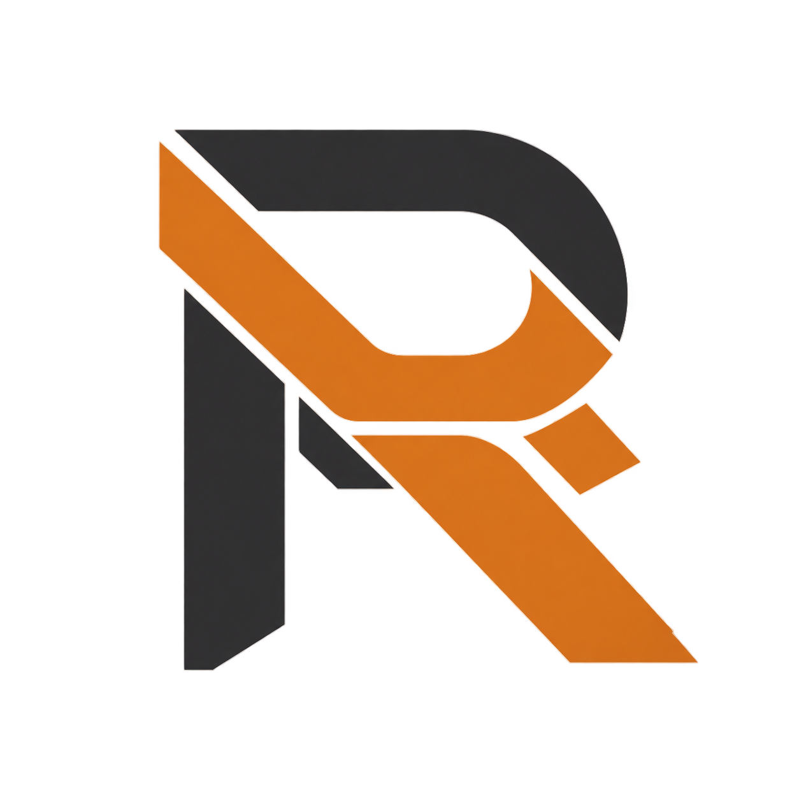
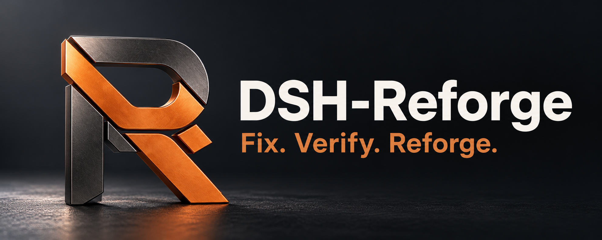

# DSH-Reforge 品牌素材

2026-10-23。T035 / [Issue #80](https://github.com/wang1299/dsh-reforge/issues/80) 制作原始 Logo 与米白主视觉；T036 / [Issue #83](https://github.com/wang1299/dsh-reforge/issues/83) 改为纯英文深色主视觉及图外中文标语；T037 / [Issue #86](https://github.com/wang1299/dsh-reforge/issues/86) 采用用户选定的第二轮 E「精密金属」版。当前首页使用 v3，旧 v1/v2 和独立 Logo 保留。素材通过内置 imagegen 生成或编辑；没有使用 API Key 或 CLI 回退，也未复制其他插件或 DeepSeek 官方标志。

## 素材

| 文件 | 规格 | 用途 |
|---|---|---|
| [透明 Logo](assets/dsh-reforge-logo-v1.png) | 1254×1254，RGBA PNG，530698 字节 | 项目标志、介绍页和宣传材料 |
| [当前首页主视觉 v3](assets/dsh-reforge-hero-v3.png) | 1983×793，RGB PNG，1869934 字节 | 中英文 GitHub README 精密金属宽幅横图 |
| [历史首页主视觉 v2](assets/dsh-reforge-hero-v2.png) | 1983×793，RGB PNG，1683027 字节 | 深色锻造旧版，保留原文件 |
| [历史首页主视觉 v1](assets/dsh-reforge-hero-v1.png) | 1983×793，RGB PNG，1419460 字节 | 米白底旧版，保留原文件 |

<p align="center">
  
</p>

<p align="center">
  
</p>

<p align="center"><strong>修复有据，经验可循。</strong></p>

## 设计与使用

标志由交叠的 R 形带状结构构成，以石墨黑与铜橙表达“重铸”。当前 v3 采用精密金属构图：左侧拉丝石墨黑/铜橙 R，右侧白色产品名和铜橙短标语，深色背景与克制反射。旧 v2 为右侧立体 R 的锻造构图，v1 为米白底和淡工程网格。主视觉是品牌插画，不是实际 UI 截图、验收证据或收益证明。

当前图内仅有两项文字：

- DSH-Reforge
- Fix. Verify. Reforge.

中文“修复有据，经验可循。”是图片下方的居中 HTML 文本，不嵌入图片。中英文 README 的图像、中文标语、npm/DSH/CI/MIT 徽章和导航分别使用居中段落；HTML 块内采用完整 `<a>` 和 ``，避免 Markdown 在 HTML 内不被解析。只参考用户示例的居中排版，未使用其中的图像或产品文案。

使用原始宽高比，不拉伸、不截断标志或横幅文字。Logo 保持 alpha 透明通道；浅/深背景应核对对比度，极小尺寸需另行检查。素材为 PNG，不是可编辑矢量源。首页采用公开完整图像地址，便于 npm 页面读取 README；品牌图继续位于发行白名单外。

后续替换应建立新版本文件并同步两份 README。“Fix. Verify. Reforge.”描述修复、来源检查与经验整理的工作流，不保证自动修复成功或未来收益。社区身份、实际支持范围和收益限制仍由首页正文说明。品牌素材随仓库 MIT 许可提供。

## 文件摘要

- Logo SHA256: `b918ac0764d36ac6c9fb6f0975cbc8bfad80f8786d74b3139c1c87c1f462c7f0`
- Hero v3 SHA256: `3af5982e96bd6c3b019dab5e76a145f8dfb2aecfb8812662d06cc97f9073ef58`
- Hero v2 SHA256: `53b94f31c4c06cb2bf1ea562b86f40bbf33eaed6335fb6cbb95bcfafcad45bc5`
- Hero v1 SHA256: `b014db603ff842edb4b6c661fa41393257543e308472317e6bee0a6647520360`

## 当前 v3 生成提示词

原始 Logo 作为品牌标志参考，使用下列实际提示词生成第二轮 E 备选。用户选图附件与 E 原图解码后的像素完全一致；仓库采用较小的原始生成 PNG，未重新生成、裁切或修改图像。

<details>
<summary>精密金属 v3 · ads-marketing · 内置 imagegen · 不透明背景</summary>

```text
Use case: ads-marketing.
Asset type: a finished wide GitHub README homepage hero banner for the DSH-Reforge open-source community plugin. Generate a single full-bleed landscape banner, aspect ratio 5:2 (target 1920 by 768), with generous 6% safe margins.
Input image 1 is ONLY the existing brand-mark reference: preserve its recognizable interlocking geometric R silhouette, graphite upper arch and left stem, copper-orange crossing band and diagonal leg, and small detached copper diamond. Render it in the requested medium without inventing a different logo.
The image must contain ONLY these two exact text strings, in tasteful, exceptionally legible sans-serif typography:
"DSH-Reforge"
"Fix. Verify. Reforge."
Render the name with exactly that capitalization and hyphen, on ONE line. The short slogan must appear directly beneath it, large enough to read in a GitHub README at 840px width. Do not put any Chinese, captions, labels, tiny footer, additional words, pseudo-code, badges, official DeepSeek logos, watermarks, or performance claims inside this image. The Chinese slogan will be placed outside the image later.
Polished, restrained, memorable professional developer-tool branding; not a game poster, not crypto art, not a UI screenshot. Text may not overlap the logo.
Art direction: PRECISION INDUSTRIAL PRODUCT PHOTOGRAPHY, a quiet slate-charcoal studio, an actual sculptural R emblem in finely brushed graphite titanium with satin copper-orange inlays and bevels, standing on the LEFT 35% of the scene. Use a very shallow plinth and precise soft top-left studio light, honest fine metal grain, controlled warm reflections, elegant depth, crisp original R silhouette, no dramatic orange aura. Keep the RIGHT 60% calm and dark, with the exact product name in large warm-white type and exact slogan beneath in muted copper. A horizontal camera composition, clear hierarchy, premium physical craft, generous empty space. Background subtly grades from slate #24282e to charcoal #111316. No flames, sparks, smoke, hard diagonal light beams, circuitry or excessive texture.
```

</details>

## 历史 v2 编辑提示词

以用户选定的深色主视觉为基础进行文字编辑，下面保留最终版本的实际提示词。

<details>
<summary>深色主视觉 v2 · text-localization · 内置 imagegen · 不透明背景</summary>

```text
Use case: text-localization. Image 1 is the edit target: the user's selected dark graphite-and-copper DSH-Reforge hero. Revise only the typography area on the LEFT. Final image must contain EXACTLY TWO text elements: the existing headline 'DSH-Reforge' and the new short English tagline 'Fix. Verify. Reforge.' beneath it. Keep the headline lettering and overall brand identity. Remove ALL Chinese characters completely, remove the old long English sentence, and remove the small 'DeepSeek Harness community plugin' footer completely. Do not leave ghost text, patches or placeholder glyphs. Rebalance the two-line text block elegantly in the left half: large warm-white bold product name, thin existing copper separator, then a comfortably large crisp warm-white tagline 'Fix. Verify. Reforge.' on one line. Spacious, readable and powerful, with room between text and logo. Preserve everything else: wide approximately 5:2 canvas, deep graphite black background, diagonal copper construction lines, warm edge lighting, original large copper/graphite R emblem on the RIGHT, material finish and floor reflections. No Chinese anywhere, no other English words, no labels, no subtitle/footer, no new decorations, no existing company logos, no watermark. This is a precise revision of the existing banner, not a new redesign. Opaque background.
```

</details>

## 历史 v1 生成提示词

下面保留 T035 实际使用的提示词，对应独立 Logo 和历史米白 v1。原始生成文件另有本机副本，仓库引用只使用本仓库素材。

<details>
<summary>Logo · logo-brand · 内置 imagegen · 透明背景</summary>

```text
Use case: logo-brand. Asset type: original transparent PNG logo mark for the open-source developer project DSH-Reforge (npm dsh-reforge), a community plugin that builds traceable experience from test-verified Python bug fixes. Primary request: design a single polished geometric emblem suggesting an R being reforged from two interlocking code-like bands. The silhouette should be distinctive, compact and recognizable at small sizes, with a clear R-like stem, open upper counter and angled lower leg. Integrate one small offset copper rectangular fragment as a subtle evidence/reconstruction motif, not a separate decoration. Style: minimal contemporary flat brand design, precise straight cuts, generously balanced negative space, crisp solid edges; no mockup or presentation board. Color: graphite charcoal for the principal shape and warm copper orange for the joining band/accent; a fine warm-light keyline can help the dark portion remain legible on dark backgrounds. Composition: one centered mark on a square canvas, about 70 percent of image width, generous clear padding. Transparent background, true alpha. No wordmark, no letters of text outside the symbol, no Chinese text, no gradients, no shadows, no 3D, no background shapes, no checkmark seal, no whale or existing company logos, no watermark. Original design only, not derived from any other DSH plugin.
```

</details>

<details>
<summary>首页主视觉 · logo-brand · 内置 imagegen · 不透明背景</summary>

```text
Use case: logo-brand. Asset type: finished wide GitHub README hero banner for DSH-Reforge, an experimental open-source DeepSeek Harness community plugin. Image 1 is a supporting brand-mark reference: preserve its distinctive R silhouette and interlocking graphite/copper shapes faithfully; it is NOT an edit target or a competitor reference. Create a new premium editorial technology brand banner, wide landscape approximately 5:2 (1920x768 preferred), with generous safe margins. Background: warm ivory, nearly white, a very faint precise engineering grid disappearing toward the edges, restrained technical drawing lines. Composition for a README header: elegant large typography occupying the left half, the supplied R emblem occupying the right half as a clean near-flat graphite/copper sculptural form; substantial whitespace between them, all comfortably inside the canvas. A few tiny warm copper rectangular fragments can converge into the mark, conveying repair evidence being reforged into structured experience, but keep it sparse. Color and mood: warm copper orange, graphite black, ivory; calm, precise, credible developer tooling, not neon sci-fi. Exact text, no other text: headline 'DSH-Reforge' (spelled D S H hyphen R e f o r g e), secondary Chinese line '从修复证据中积累经验', small English line 'Traceable experience from verified fixes.', and understated footer 'DeepSeek Harness community plugin'. Use crisp modern sans-serif typography, very legible Chinese characters, excellent hierarchy; no text overlap with emblem, no tiny pseudo-code. The hero must feel designed as one coherent brand system with the supplied logo. No fake UI, no performance charts or claims, no shield/security certification, no official DeepSeek logo, no whale, no third-party brand, no mockup device, no watermark. Opaque background.
```

</details>
