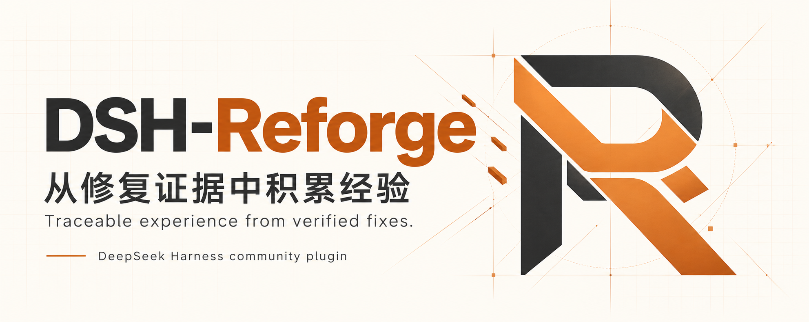

# DSH-Reforge 品牌素材

2026-10-23，T035 / [Issue #80](https://github.com/wang1299/dsh-evolve/issues/80)。两张图通过内置 imagegen 生成，并保存为仓库内的 PNG；没有使用 API Key 或 CLI 回退，也未复制其他插件或 DeepSeek 官方标志。

## 素材

| 文件 | 规格 | 用途 |
|---|---|---|
| [透明 Logo](assets/dsh-reforge-logo-v1.png) | 1254×1254，RGBA PNG，530698 字节 | 项目标志、介绍页和宣传材料 |
| [首页主视觉](assets/dsh-reforge-hero-v1.png) | 1983×793，RGB PNG，1419460 字节 | 中英文 GitHub README 宽幅横图 |

<p align="center">
  
</p>



## 设计与使用

标志由交叠的 R 形带状结构构成，以石墨黑与铜橙表达“重铸”；偏离主体的小块对应修复材料被整理、连接的意象。主视觉使用同一标志、米白底和淡工程网格。它是本产品的品牌插画，不是实际 UI 截图、验收证据或收益证明。

主视觉文字：

- DSH-Reforge
- 从修复证据中积累经验
- Traceable experience from verified fixes.
- DeepSeek Harness community plugin

使用原始宽高比，不拉伸、不截断标志或横幅文字。Logo 保持原始 alpha 透明通道；浅色或深色底均应核对对比度，极小尺寸需另行检查。它是 PNG，不是 SVG 或可编辑矢量源文件。中英文首页使用完整的公开图像地址，便于 npm 页面读取 README；素材继续位于发行白名单外，不增加到已有安装包中。

后续替换应建立新的版本文件，并同步两份 README。文字中的“verified fixes”指来源修复的测试检查，不能解释成已验证未来收益。品牌素材随仓库 MIT 许可提供。

## 文件摘要

- Logo SHA256: `b918ac0764d36ac6c9fb6f0975cbc8bfad80f8786d74b3139c1c87c1f462c7f0`
- Hero SHA256: `b014db603ff842edb4b6c661fa41393257543e308472317e6bee0a6647520360`

## 最终提示词

下面保留最终实际使用的提示词；图形结果以本页 PNG 为准。第二次生成以第一张 Logo 为品牌参考，不是编辑其他项目的图片。原始生成文件另有本机副本，仓库引用只使用本仓库素材。

<details>
<summary>Logo · logo-brand · 内置 imagegen · 透明背景</summary>

```text
Use case: logo-brand. Asset type: original transparent PNG logo mark for the open-source developer project DSH-Reforge (npm dsh-reforge), a community plugin that builds traceable experience from test-verified Python bug fixes. Primary request: design a single polished geometric emblem suggesting an R being reforged from two interlocking code-like bands. The silhouette should be distinctive, compact and recognizable at small sizes, with a clear R-like stem, open upper counter and angled lower leg. Integrate one small offset copper rectangular fragment as a subtle evidence/reconstruction motif, not a separate decoration. Style: minimal contemporary flat brand design, precise straight cuts, generously balanced negative space, crisp solid edges; no mockup or presentation board. Color: graphite charcoal for the principal shape and warm copper orange for the joining band/accent; a fine warm-light keyline can help the dark portion remain legible on dark backgrounds. Composition: one centered mark on a square canvas, about 70 percent of image width, generous clear padding. Transparent background, true alpha. No wordmark, no letters of text outside the symbol, no Chinese text, no gradients, no shadows, no 3D, no background shapes, no checkmark seal, no whale or existing company logos, no watermark. Original design only, not derived from any other DSH plugin.
```

</details>

<details>
<summary>首页主视觉 · logo-brand · 内置 imagegen · 不透明背景</summary>

```text
Use case: logo-brand. Asset type: finished wide GitHub README hero banner for DSH-Reforge, an experimental open-source DeepSeek Harness community plugin. Image 1 is a supporting brand-mark reference: preserve its distinctive R silhouette and interlocking graphite/copper shapes faithfully; it is NOT an edit target or a competitor reference. Create a new premium editorial technology brand banner, wide landscape approximately 5:2 (1920x768 preferred), with generous safe margins. Background: warm ivory, nearly white, a very faint precise engineering grid disappearing toward the edges, restrained technical drawing lines. Composition for a README header: elegant large typography occupying the left half, the supplied R emblem occupying the right half as a clean near-flat graphite/copper sculptural form; substantial whitespace between them, all comfortably inside the canvas. A few tiny warm copper rectangular fragments can converge into the mark, conveying repair evidence being reforged into structured experience, but keep it sparse. Color and mood: warm copper orange, graphite black, ivory; calm, precise, credible developer tooling, not neon sci-fi. Exact text, no other text: headline 'DSH-Reforge' (spelled D S H hyphen R e f o r g e), secondary Chinese line '从修复证据中积累经验', small English line 'Traceable experience from verified fixes.', and understated footer 'DeepSeek Harness community plugin'. Use crisp modern sans-serif typography, very legible Chinese characters, excellent hierarchy; no text overlap with emblem, no tiny pseudo-code. The hero must feel designed as one coherent brand system with the supplied logo. No fake UI, no performance charts or claims, no shield/security certification, no official DeepSeek logo, no whale, no third-party brand, no mockup device, no watermark. Opaque background.
```

</details>
