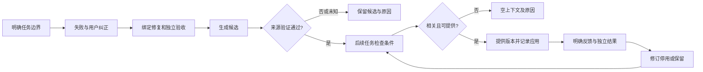

# DSH-Evolve 产品需求 v0.2

> 核心体验：**“这个问题我上次纠正过，这次 Agent 能自己注意到。”**

## 1. 文档地位与阅读约定

日期：2026-10-19。任务：[T009 / Issue #27](https://github.com/wang1299/dsh-evolve/issues/27)。T009运行核对基线为`bd724ccf03eb50314b29e132df1cbf6210c6c81c`；T010从已合并`bdf778cd0fc8172e3a2da976f72b17df6eb2ad4f`实现事实来源切片，见[ADR013](decisions/013-fact-evidence.md)。这是文档v0.2；npm仍为`0.1.0-alpha.0`，没有发布新包。

本文件规定产品目标、行为与验收；[架构总纲](architecture.md)规定实现边界、当前契约和目标设计；[ADR](decisions)保留选择与变更理由。需求变化先更新本文件，持久化及公开接口变化另作任务设计。冲突时报告差异，不能用架构中的计划覆盖实际代码。

| 标记 | 含义 | 不能推导出的结论 |
|---|---|---|
| 已实现 | 当前代码存在相应路径 | 不代表真实用户会话已验证 |
| 已验证 | 有指定版本、环境、输入及结果 | 不外推到其他平台、任务或模型 |
| 部分覆盖 | 一部分路径存在，其余缺口明列 | 不按整个需求完成计数 |
| 目标 | 产品要求，尚需任务实现 | 不是可调用API或已有数据库字段 |
| 已发布 | 有实际公开发行物 | GitHub源码、本机tgz均不等于发布 |

需求ID后续保持稳定。`G01–G10`是[架构缺口](architecture.md#16-缺口与实施依赖)；`A1–A8`沿用首版验收编号。“已验证”须结合证据范围，不能只看测试名称。

## 2. 问题、用户与价值

### 2.1 要解决的问题

开发Agent在不同任务中重复犯相同错误。用户上次的纠正可能只留在旧对话；普通长期记忆又可能忽视代码版本、测试证据和反例，把过时建议反复带入上下文。

DSH-Evolve积累的是**有来源、有限适用范围、能重新验证和停用的修复经验**。优化对象是经验内容、资格、选择和反馈策略；不修改模型权重，不保证每次任务更好。

### 2.2 用户与职责

| 角色 | 工作 | 权限与责任 |
|---|---|---|
| 仓库owner／开发者 | 日常修复少重复纠正，查看和修改经验 | 授权执行与共享，明确反馈，维护验收 |
| 当前DSH Agent | 记录任务、提出候选，按相关经验检查修复 | 不能授予验证状态、伪造owner反馈或改变授权 |
| 验证执行器 | 对固定版本执行独立验收与回归 | 证明运行事实，不认证自然语言策略普遍正确 |
| 经验核心 | 管理来源、资格、选择、版本与反馈 | 证据不足时拒绝应用，保留原因 |
| 实验维护者 | 固定三组对照，报告失败与成本 | 隔离积累／评价，不冒充真实用户评价 |

首位目标用户是自己维护一个Python仓库、已有pytest、愿意纠正少量经验的开发者。团队共享、多租户和跨仓库记忆不属第一版。

### 2.3 典型场景

1. Agent把合法的`0`当成缺省值，用户明确纠正；独立测试在旧commit失败、修复commit通过。
2. 保存“何时该区分缺失与假值”的候选，限定仓库、相关文件和依赖，取得来源验证。
3. 后续相似任务先检查条件，再选一条经验。匹配不足时保持空上下文。
4. “不相关”只排除这一精确任务表述；策略有反例时停用实际应用版本。
5. 依赖或条件代码变化后不再应用；修订／恢复后重新验证。

这是示例问题族，不是将一次成功泛化为所有真假值处理规则。

## 3. 范围与交付层次

### 3.1 五个模块

| 模块 | 输入 | 用户得到什么 | 第一版边界 |
|---|---|---|---|
| 轨迹采集 | 显式任务、纠正、相关事件、Git／测试 | 可解释的归属与必要来源 | 不存完整会话、任意工具输出 |
| 经验提取 | 失败、修正、验证依据 | 事实／推断／建议分开的候选 | 允许工具提交；自动提取未实现 |
| 可执行验证 | 前后commit、外部验收、执行策略 | 修复证明或未通过原因 | Python＋pytest、受信任代码、文件隔离 |
| 选择与应用 | 新任务、条件、经验与反馈 | 少量上下文、拒绝理由、应用记录 | 每任务最多一条，可不提供 |
| 版本与淘汰 | 反馈、修订、反例及版本变化 | 历史、停用、恢复为候选 | 不回滚用户代码 |

### 3.2 三层完成标准

| 层次 | 必须证明 | 当前情况 |
|---|---|---|
| 核心闭环 | 真实pytest失败→修复→候选→验证→另一任务选择→反馈／版本 | 合成Git仓库核心案例已验证 |
| 正常DSH体验 | 用户照常开发，准确采集，真实模型回合触发工具与复用 | 六工具官方探针通过；T011真实SDK begin/纠正/有效修复已观察，候选引用失败，完整模型闭环仍待验证 |
| 实际收益 | 未见任务三组公平对照，报告错误经验、返工和成本 | 小型合成Codex初步实验，未观察到验收改善 |

不能将核心案例或安装成功宣称为实际收益。

### 3.3 第一版非目标

- 跨仓库市场、团队权限、云同步、公开上传用户经验。
- 自动训练模型、演化全局系统提示、无人监督修改业务代码。
- 任意语言兼容、恶意代码安全沙箱、精确重建全部运行环境。
- 把所有聊天转为Skill、用Skill数量衡量效果。
- 自动回滚用户代码、接受模型自评、自动发布包或服务。

Skill可作为后续交换格式；当前MVP门槛在验证、条件、选择与更新。

## 4. 用户流程

### 4.1 首次配置

1. owner指定精确Git根、可解释的数据目录、Python及外部验收目录。
2. 默认不执行代码、不共享经验；分别开启`executionTrusted`与`shareWithModel`。
3. 插件绑定仓库和session，其他仓库会话不能借此读写。
4. 检查插件运行状态；经验管理用独立本机面板，DSH插件详情不是经验面板。
5. 没有前后commit或外部验收时先保留候选。

`shareWithModel`目前只授权向当前Agent返回已存经验；**不构成未来自动提炼上传原始材料的授权**。提炼须另定义材料范围、模型边界和预算。

### 4.2 目标主流程

任务是需要验收的修复目标，不按消息、工具调用或时间片切割。idle、turn结束、自称完成只可触发检查，不可产生`accepted`或`source_verified`。

### 4.3 当前可执行流程

Agent显式调用`evolve_begin_task`；同session同时仅一个open任务。记录纠正，提交修复，`evolve_propose_experience`提交候选，`evolve_verify_experience`验证。不要求结束任务后才能提候选；结束只关闭采集／选择边界。

验证比较任务起始commit与当前修复HEAD，用owner提供的外部pytest。另一任务begin在共享开启时尝试选择，返回精确版本、应用及原因。纠正与验证返回来源凭据，候选返回事实摘要；`evolve_link_fact_evidence`关联同任务来源：相同集合幂等；来源完整且已验证时锁定，owner须检查反馈并显式内容修订后才可更换；其他来源变化追加新revision。默认evidence-v1要求每条事实有完整有效引用。用户在面板查看/关联事实来源、追加反馈、修订、停用或恢复。当前没有自动证据归并、后台LLM提炼或模型可写owner反馈的工具。

### 4.4 异常与人工接管

| 情况 | 产品要求 | 现状／缺口 |
|---|---|---|
| 无open任务、session／仓库不符 | 拒绝错误归属，不猜测补绑 | 工具检查已有；自动边界G01 |
| 无commit／验收或未信任 | 不执行或不授予证明 | 已有；基础设施错误返回调用方 |
| 不复现／跳过失败用例／回归失败 | 候选及原因 | 报告已有；中断Attempt持久化G03 |
| 条件变化 | 不应用，不伪称适用 | 按需过滤已有；主动提醒G09 |
| 无匹配／预算不足 | 普通开发可继续 | 无匹配已有；DSH硬预算G04 |
| 旧页面修改新版 | 提示刷新，不覆盖 | revision冲突409已有 |
| 提炼失败／断电 | 不阻塞开发，重启不重复写 | 目标G02/G03 |
| 事件监听失败 | 最小诊断，运输成功不当验收 | 监听器隔离已有；全流程G05 |

## 5. 领域、证据与状态

| 概念 | 可依赖的含义 | 不代表 |
|---|---|---|
| Task | session内显式修复目标、起始版本 | 一条消息或成功 |
| Candidate | 待验证策略及主张 | 通用可信知识 |
| Observed fact | 应可指向来源的事实主张 | 写进数组就为真 |
| Inference／Recommendation | 推断／待验证建议 | pytest已证明的事实 |
| Verification | 特定commit与固定验收的运行证明 | 策略全文正确或未来收益 |
| Application | 选择返回精确经验版本的记录 | 模型读过、采用或因它成功 |
| Feedback | 对该次应用的追加反馈 | 自动因果奖励 |
| Revision | 不可变的状态／内容历史 | 用户代码commit或原地覆盖 |

Task只有`open/closed`；closed不表示通过。经验只有`candidate/source_verified/disabled`。“过时”“正在验证”“有益”不是现行枚举；漂移目前只影响选择资格。

内容修订、恢复、停用和验证结果产生新revision。相同事实引用保存保留原revision及反馈；来源完整且已验证的经验拒绝来源变化，避免仅靠元数据修订绕过负反馈。owner须检查反馈并显式内容修订后再编辑。其他真实来源变化产生新revision并保留当时状态/证明；候选/停用不因此获得验证资格。恢复复制旧内容到新候选并清空验证引用；不能激活旧证明。反馈指向实际Application的revision，旧版反例不能停用新版。

事实正文仍是字符串数组，引用按经验revision保存在侧表。每条事实最多3个来源；校验fact hash、证据hash、task/repo及来源完整性。“来源已验证”仍仅指修复运行；引用不证明自然语言主张被来源蕴含，语义核对仍为G02。旧数据无引用时可查看/重验，但默认不会自动复用。

## 6. 编号需求

现状以本代码基线为准；[架构追踪](architecture.md#15-需求到实现与验证的追踪)给出模块、测试与缺口。

### 6.1 产品与任务边界

| ID | 要求与验收要点 | 现状 |
|---|---|---|
| B01 | 单仓库Python＋pytest完整闭环，无经验仍可开发 | 核心已验证；正常DSH模型G05 |
| B02 | 来源验证与后续收益独立，禁止一个成功标签替代 | 已实现，持续约束 |
| B03 | 策略恢复不修改／回滚用户代码 | 已实现 |
| B04 | 计划、实现、验证、发布分开，保存失败未知 | 已执行；未发布 |
| T01 | 绑定session、精确仓库、起始commit及摘要 | 显式工具已实现 |
| T02 | 同session仅一个open；越session／仓库拒绝 | 已实现；重复begin报错 |
| T03 | 结束只关闭边界；idle／turn／自评非正确证明 | 已实现；自动调度G03 |
| T04 | 明确纠正归属任务，歧义纠正不自动推广 | 显式已有；自动归属G01 |
| T05 | 中断、重启、重复事件可解释，不重复授予成功 | 事件ID去重已有；耐久恢复G03 |

### 6.2 采集与提取

| ID | 要求与验收要点 | 现状 |
|---|---|---|
| C01 | 仅必要摘要／允许字段，不存完整聊天及任意参数输出 | 最小元数据已有 |
| C02 | 失败、纠正、修复、工具、测试归属同任务 | Git／测试已有；错误尝试归并G01 |
| C03 | 固定commit、diff、验收内容／摘要和环境 | 已实现；非完整环境重建 |
| C04 | 逐条事实可溯源，缺来源保持候选或拒绝主张 | T010已有显式纠正/验证的逐条引用；自动归并G01、语义核对G02 |
| C05 | 解释清理，不留下无依据却可用的经验 | T010保留所有历史revision引用的最小来源；遗忘/导出G07 |
| C06 | 条件来自快照，安全路径，不越仓库取文件 | 已实现；条件充分性需评价 |
| E01 | 候选含条件、问题、策略、验证、来源及版本，拒绝未知字段 | 候选／核心严格模式已有 |
| E02 | 事实、推断、建议分开；未验证不自动应用 | 结构/出处校验已有；文字核对G02 |
| E03 | 单次成功仅有限范围经验，不直接普遍化 | 精确条件已有；自动提炼G02 |
| E04 | 自动提取可关闭，最小材料、独立授权、预算、失败状态 | 目标G02/G03 |
| E05 | 同源重复提取不重复创建，冲突保留证据供修订 | 目标G02/G03；propose目前新UUID |

### 6.3 来源验证

| ID | 要求与验收要点 | 现状 |
|---|---|---|
| V01 | owner信任才执行；固定pytest，不开放任意shell | 已实现 |
| V02 | 前后独立临时目录，验收在Agent修改范围外 | 已实现；强隔离G08 |
| V03 | 真实失败→同一失败用例实际通过，跳过／删除不算 | 已实现用例身份检查 |
| V04 | 回归通过，无收集／错误／超时不算通过 | 已实现 |
| V05 | 保存验收、摘要、命令、环境、用例、必要diff | 已实现；公开重建资产G06 |
| V06 | 取消、进程错误、材料变动保持未验证及可解释结果 | 报告／返回错误已有；耐久Attempt／进程树G03/G08 |
| V07 | 仅匹配来源的报告授予状态，旧结果不覆盖修订 | 已实现revision及事务检查 |

### 6.4 选择与上下文

| ID | 要求与验收要点 | 现状 |
|---|---|---|
| S01 | 先检查仓库、依赖、条件文件、来源及状态 | evidence-v1新增完整事实引用门槛；精确条件已有，主动漂移G09 |
| S02 | 排除来源任务，少量经验，无合适项拒绝提供 | 最多一条；跨进程去重G03 |
| S03 | 版本化排序，记录理由及应用精确版本 | 已有；完整决策快照G04 |
| S04 | 观察反馈更新选择，unknown非成功，负反馈可纠正 | feedback-v1检索内核已有，evidence-v1先检查事实来源 |
| S05 | 共享需owner授权，历史文本按不可信数据处理 | 开关／提示已有；DTO／硬预算G04 |
| S06 | 区分选择、返回、采用和结果，未知保持未知 | Application仅选择返回路径；交付采用G04/G05 |
| S07 | 上下文大小、条数、额外成本有边界，不足拒绝或缩减 | 条数／字段上限已有；总预算G04 |

### 6.5 生命周期与界面

| ID | 要求与验收要点 | 现状 |
|---|---|---|
| L01 | 反馈追加可纠正、关联应用，模型不伪造owner反馈 | 已有；核心API信任调用方 |
| L02 | 当前版rejected／counterexample停用，旧版不影响新版 | 已实现 |
| L03 | irrelevant精确上下文拒绝，非策略失败 | 已实现；换措辞有限 |
| L04 | 修订／恢复新候选、新验证，保留原因与历史 | 已实现 |
| L05 | 条件变化重查，过时经验不默认应用 | 选择时已有；主动提醒G09 |
| L06 | 记录成本、返工及未知，空值不当零 | 字段已有；单位／表述G10 |
| U01 | 查看经验、条件、来源、证明、历史、应用和反馈 | 已实现及本机交互验证 |
| U02 | 明确状态及来源验证局限 | T010已显示每版事实来源与完整性；自动流程状态随G01–G04 |
| U03 | 保护修改、反馈；旧页不覆盖新版 | token／同源／revision已有 |
| U04 | 正常会话与面板联动，错误可恢复，不手工拼证据 | 分离页／显式工具已有；G01/G05 |

### 6.6 数据、接入与评价

| ID | 要求与验收要点 | 现状 |
|---|---|---|
| D01 | 默认本机，路径可解释，不静默上传会话凭据 | 已有；未来导出G07 |
| D02 | 限长、脱敏、安全路径，不保证规则识别所有隐私 | 模式规则已有 |
| D03 | 普通事件30天，引用证据独立保留 | T010已保留历史引用的纠正/验证来源；完整遗忘G07 |
| D04 | 执行、共享、提炼传输分别授权，模型／HTTP不能提权 | 两开关已有；提炼G02 |
| D05 | 迁移保历史、拒未知格式，说明降级混跑限制 | SQLite v3已有，v1/v2保历史，旧程序不能混跑/降级 |
| I01 | 固定DSH发行版，官方服务／包／实际安装验证 | 0.2.0-rc.2组件及Windows完整Web已验证 |
| I02 | 事件仅观察，工具运输成功不等于pytest通过 | 已实现 |
| I03 | 卸载取消待执行验证并释放资源 | 取消/等待pending经源码核对；探针仅验证卸载移除工具/提示，实际取消未专项运行；断电G03 |
| I04 | 分开组件、完整应用、模型回合及平台覆盖 | 已执行；真实DSH／Desktop／其他平台G05 |
| Q01 | 原始／普通检索／完整机制三组，控制模型任务预算环境 | 执行器已有；真实任务集G06 |
| Q02 | 积累／未见评价分开，外部验收，评价反馈不泄漏 | 协议已有；公开重建G06 |
| Q03 | 成功、复发、返工、误用、成本，明确分母未知 | 格式已有；完整观测G06/G10 |
| Q04 | 未启动、失败、退步、无改善、全部调用保留 | 已实现；历史结果不改写 |
| Q05 | 方法讲清输入输出反馈负反馈数据限制，少样本仅初步 | 方法／初步实验已有 |

## 7. 选择和更新的方法要求

当前采用规则与BM25，理由是数据少、需先排除来源及资格错误。详见[方法](methods.md)及[架构算法](architecture.md#9-资格排序和上下文交付)。

| 阶段 | 输入→输出 | 反馈／数据需求 | 负反馈与限制 |
|---|---|---|---|
| 资格 | 快照＋来源→合格集合 | 一条修复可检查 | 精确hash保守，条件不充分可误用 |
| 相关性 | 摘要＋文字→候选或拒绝 | 无训练数据 | 不理解否定，首次同义任务漏选 |
| 效用 | 同revision反馈→平滑分数 | 零反馈中性；少量无统计结论 | unknown／irrelevant不计成败，有选择偏差 |
| 反馈检索 | accepted应用摘要→最多8个备用表述 | 至少一条accepted | 错误反馈污染；拒绝只精确匹配 |
| 生命周期 | 反例／修订→停用或新候选 | 人工反馈／独立结果，来源标清 | 旧版不归因新版，不回滚代码 |

MemRL、GEPA、ExpeL的已核实对象与取舍见方法说明；当前不是论文复现。embedding、提示搜索或学习排序应由冻结任务上的漏选、误用和对照结果决定。

## 8. 数据、授权与清理

保存最小任务摘要、显式纠正事件、候选／历史、精确条件、必要验证输入结果、应用反馈。监听器只记类别／工具名等，不复制完整消息、参数或输出。

文本限长和模式脱敏不能保证删除所有隐私。传给Agent或未来提炼器之前仍须授权；诊断不得打印凭据、完整启动URL或原始报告。

默认目录为用户home下`.dsh/evolve/<repoId>`，显式`dataDir`覆盖；**不随DSH_HOME自动迁移**。repoId由本地Git根生成，移动／clone不自动共享。配置、数据库不提交Git。

普通清理事务删除30天前events及未被任何历史revision引用的过期最小来源；引用中的纠正和验证来源继续保留，不删除任务摘要、验收、证明、应用、反馈和历史。事件只留纠正来源ID，最小纠正文保存在evidence。未引用来源会到期，后续补引用须仍然存在；不静默重建或伪造旧来源。

批量清空、导出、自动遗忘尚未实现。删除设计须规定哪些经验失去资格、来源缺失提示及隐私副本处理；不靠删除用户代码清理。

## 9. 黄金验收场景

产品场景不是测试数量目标。已有核心测试不能冒充未来自动流程通过。

| 场景／关联 | 前置与操作 | 预期与拒绝路径 | 当前依据／门槛 |
|---|---|---|---|
| AC01 / A1 | session begin、纠正、结束 | task/session/repo/base绑定；跨session拒绝；closed非成功 | dsh／core；自动归属G01 |
| AC02 / A2 | 旧失败、修复通过、固定验收 | 同用例失败→通过、回归通过；存输入环境diff | core真实pytest、demo |
| AC03 / A2 | 改验收、删／跳过、无收集、超时 | 不授予证明；报告或明确基础设施错误 | core已测解析器/用例身份/skip/无收集及timeout标志；evidence测试拒绝存储报告改动；执行中验收变动、实际pytest超时未专项运行，耐久Attempt G03 |
| AC04 / A3 | 提出事实／推断／建议／条件 | candidate不可选；来源验证不认证文字 | schema/core/evidence；逐条出处已测，语义核对G02 |
| AC05 / A4 | 另一任务相关、条件一致 | 一条、精确revision、原因及Application | core／retrieval；DSH模型G05 |
| AC06 / A4 | 仓库／依赖／文件不符或弱匹配 | 空上下文、理由，普通开发继续 | core／repository／retrieval |
| AC07 / A5 | 当前版反例，修订后给旧应用负反馈 | 停用应用版、不停用新版、历史可查 | core／panel |
| AC08 / A5 | irrelevant重复摘要，再accepted | 精确拒绝可纠正，不停用策略 | feedback-retrieval；换措辞不保证 |
| AC09 / A5,A6 | 修订／恢复与另一连接并发 | 新候选需验，旧操作409，代码不变 | panel／migration |
| AC10 / A6 | 无token、跨源、超大请求、注入文本 | 拒绝读写，文本按数据展示 | panel已测鉴权/同源/CSP及文本载荷不内嵌HTML；体积上限/DOM文本处理经源码核对，超过32KiB请求未专项发送；大库/语义G10 |
| AC11 / A7 | 固定服务注册卸载、tgz安装 | 六工具/prompt有效，明示平台；pending取消仍未专项执行 | dsh／bundle／install-probe、T006d；G05 |
| AC12 / A8 | 三组未启动、失败、漂移、泄漏、无提供 | 不伪造可比性／暴露／成功 | evaluation／paired／feedback-experiment |
| AC13 / A1,A3 | 目标：重复事件／重启／来源不足 | 不重复、不跨任务、缺来源候选、不擅传 | 待G01–G03 |
| AC14 / A4,A6 | 目标：大经验／预算不足／交付中断 | 最小上下文或拒绝，未交付不算采用 | 待G04/G05 |
| AC15 / A3,A6 | 清理后访问历史证明 | 报告可查，未来事实引用不误删 | evidence/core已有历史引用保留；完全删除/遗忘G07 |

### 9.1 保留首版编号

| 编号 | 稳定含义 | v0.2对应 |
|---|---|---|
| A1 | 同显式任务／仓库、失败修复可追溯 | T01–T05、C02；AC01、AC13 |
| A2 | 外部固定验收旧失败／修复通过／回归通过 | C03、V01–V07；AC02、AC03 |
| A3 | 候选／来源／主张分层，未验证不应用 | C04、E01–E05；AC04、AC13、AC15 |
| A4 | 新任务条件选择，不符拒绝 | S01–S07；AC05、AC06、AC14 |
| A5 | 应用反馈、历史、修订停用恢复 | L01–L06；AC07–AC09 |
| A6 | 本机面板、受保护操作 | U01–U04、D01–D05；AC09、AC10、AC14、AC15 |
| A7 | 固定DSH、官方服务／安装／真实会话边界 | I01–I04；AC11 |
| A8 | 三组评价，失败未知保留 | Q01–Q05；AC12 |

## 10. 效果评价与验收口径

### 10.1 三组对照

| 组 | 获得什么 | 控制要求 |
|---|---|---|
| 原始Agent | 共同任务上下文 | 同请求模型、任务版本、工具／调用预算、验收、环境 |
| 普通经验检索 | 同来源库的文字检索 | 固定算法，记录选择，不偷用完整资格／反馈 |
| 完整机制 | 验证、资格、选择、版本反馈 | 精确策略／库／revision／提供证据；无提供不能判断收益 |

积累只建库，未见评价不能反向写库或调参；作者可见须明示。服务未暴露seed／权重／温度等控制则记录未知，不宣称完全确定性。

| 指标 | 口径 | 缺失处理 |
|---|---|---|
| 验收成功率 | 通过／已启动，同时报计划、未启动 | 超时失败保留，未知不补通过 |
| 同类错误复发率 | 可识别原错误的已知结果中再次失败比例 | 跳过／删除／未运行单列未知 |
| 人工返工 | 明确观察介入数及预定单位 | 未观察null，模型不估为0 |
| 错误经验应用 | 有判定证据的误用／已提供，同时报未知数 | 不能从任务成功反推经验正确 |
| 额外成本 | 积累＋评价调用、tokens、耗时、金额分列 | 缓存及未知价格明示，不只报命中收益 |

来源验证、accepted、后续验收通过都不能单独证明因果收益。不设“达到某个小样本就普遍有效”的门槛；按任务族拆分、配对重复、报告不确定性，数据少仅称初步。

### 10.2 已有证据的上限

- [T008a](evaluation/retrieval-v1.md)：36条作者可见合成查询，开发／留出各18；带资格召回均5/9→6/9，开发误选4→3、留出仍3。不是Agent收益。
- [T008c](development/T008c-acceptance.md)：一次积累＋两项新合成任务三组，共7次真实Codex调用；Evolve两题提供经验，三组都2/2通过，未观察到成功或复发改善。全流程83887输入／1192输出tokens，错误应用／返工／金额未知。
- 上述非盲测、非真实仓库泛化，仅一次重复；原始来源资产尚无可公开独立重建的完整套件。不能声称自进化已有效。

## 11. 当前交付与下一步

当前可用：本地核心闭环、DSH六工具、最小事件、来源pytest、事实引用及保留、evidence-v1条件选择/反馈检索、版本及面板；Windows完整官方Web已有T006d安装，T011更新当前插件并用官方SDK真实Agent验证为partial（候选失败，复用未开始）。组件CI、完整安装、真实模型实验分别报告。

未完成：自动失败修复证据链、授权后台提炼、耐久调度恢复、DSH总上下文预算与交付证明、正常DSH模型学习、公开重建评估、主动过时检查及面板语义。主要依赖G01→G02/G03→G04→G05；G06建立收益评价，G07–G10按风险拆任务。详见[架构缺口](architecture.md#16-缺口与实施依赖)、[路线](roadmap.md)。

T009已由PR #28完成设计；T010实现G01/G07显式引用切片，不含自动归并/提炼，无模型调用或发布。[T010验收](development/T010-acceptance.md)记录实际测试/界面/安装/评审；历史T009[设计验收](development/T009-design-acceptance.md)和关联PR记录实际检查／评审／CI。

## 12. 文档粒度参考

只读参考Run2Skill固定快照`cfd288ebd0839aa82e65b118d10a85b6b1b61f35`的[PRD](https://github.com/qkycir-123/dsh-run2skill/blob/cfd288ebd0839aa82e65b118d10a85b6b1b61f35/docs/product/prd.md)、[架构](https://github.com/qkycir-123/dsh-run2skill/blob/cfd288ebd0839aa82e65b118d10a85b6b1b61f35/docs/architecture/baseline.md)、[设计索引](https://github.com/qkycir-123/dsh-run2skill/blob/cfd288ebd0839aa82e65b118d10a85b6b1b61f35/docs/design/README.md)：借鉴编号、契约、异常矩阵、验收追踪深度。未引入Skill发布／Catalog／所有权产品，未复制实现。参考范围变更见[ADR012](decisions/012-detailed-design-baseline.md)。
